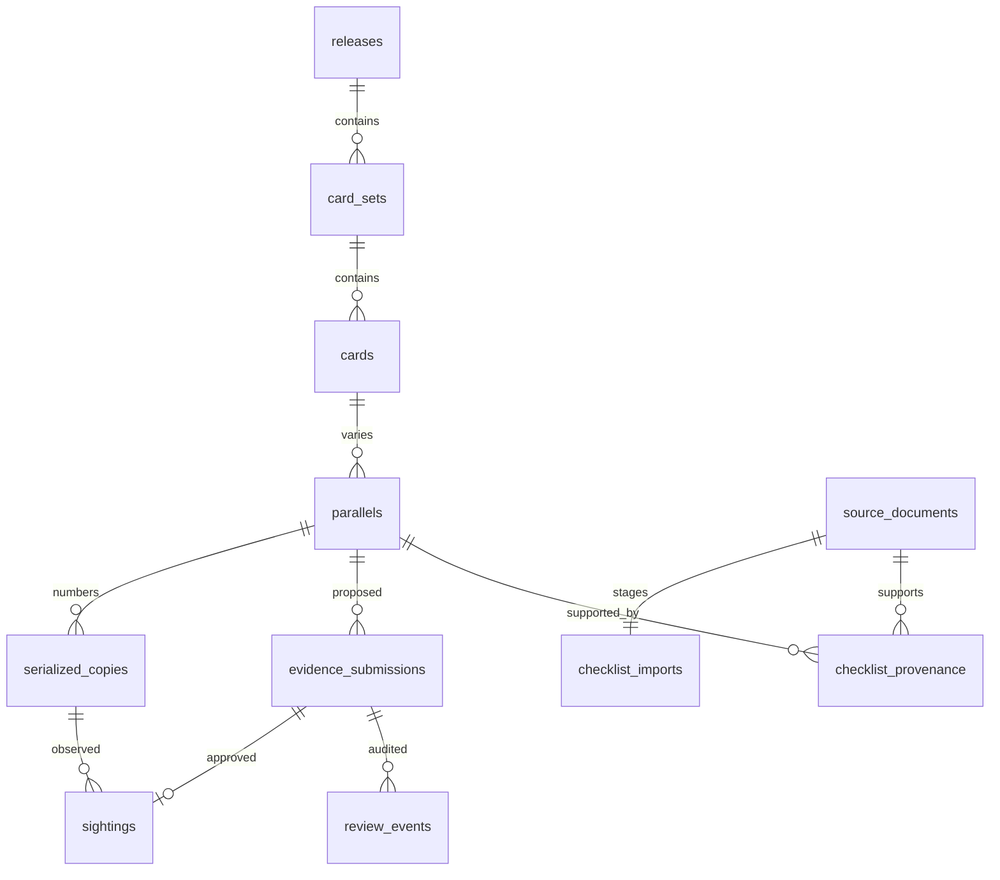

# Data model and security

- Set identity is scoped to a release; card number is scoped to a set; parallel name is scoped to a card. Case and outer whitespace normalize identity, but aliases do not merge automatically.
- Numbered-copy uniqueness is a database constraint on `(parallel_id, serial_number)`. A trigger checks the number against the published parallel's denominator. Transactional approval locks the submission, uses conflict-safe copy insertion and writes a review event. A concurrent duplicate approval cannot create two copies.
- Checklist publication locks the release and import. A conflict rolls back all rows, provenance and publication status. Source hashes deduplicate the same document within a release. Publication attests to the source and transcription; it does not imply odds or sightings.
- Pending/rejected/revoked submissions and notes stay private. Public sightings expose only the source/locator/time and copy linkage. User IDs and review reasons are not in the public sighting table.
- RLS is enabled on every table. Ordinary users may insert only their own pending submissions and read their own submissions. Reviewers get queue read access, but mutation RPCs are restricted to `service_role`. The HTTP endpoint verifies the user with Supabase Auth and checks the `admin_roles` table before constructing the privileged client; the RPC checks reviewer membership again. No authorization trusts user metadata or a client-supplied reviewer UUID.
- RPCs use invoker security with an empty search path. Public execute grants are revoked. Views use `security_invoker=true`. Public source-document grants expose only provenance columns; original extraction and reviewer IDs remain service-only.
- Counts include distinct canonical copies with active sightings. Revocation removes a sighting; a copy remains counted while another approved sighting still supports it.
- API JSON bodies have streamed size limits. Submitted URLs are validated as HTTPS and rendered as ordinary links, never fetched automatically. CSV/PDF parsing runs as an explicit local administrator operation with size limits and PDF JavaScript evaluation disabled.

The embedded database tests validate SQL behavior with simulated auth functions. Hosted JWT issuance, Auth email setup, PostgREST relationship discovery, connection failure behavior and browser sign-in must also pass the development-project smoke test before launch. Public catalog display is capped at 1,000 variants and samples evidence links; admin queues show the newest 100 submissions / 30 imports. Add pagination before larger releases or queues.
